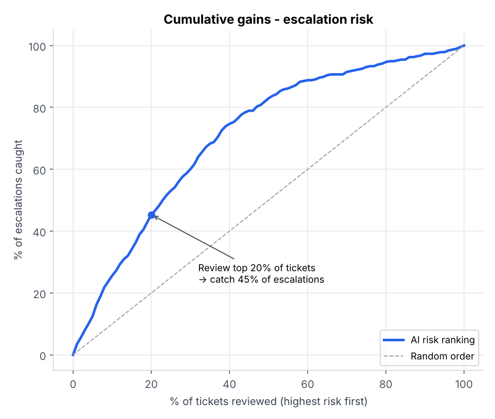
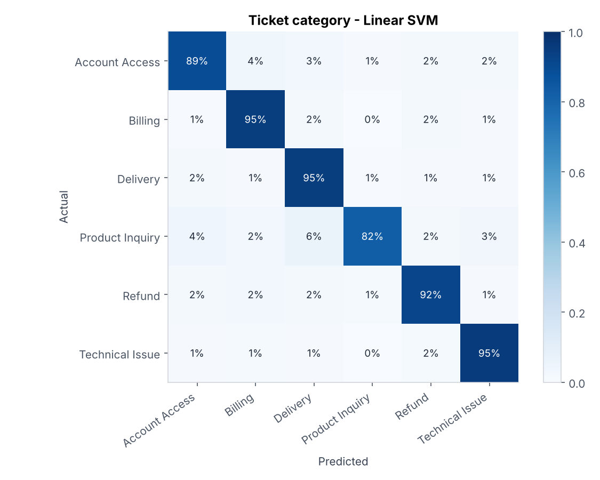
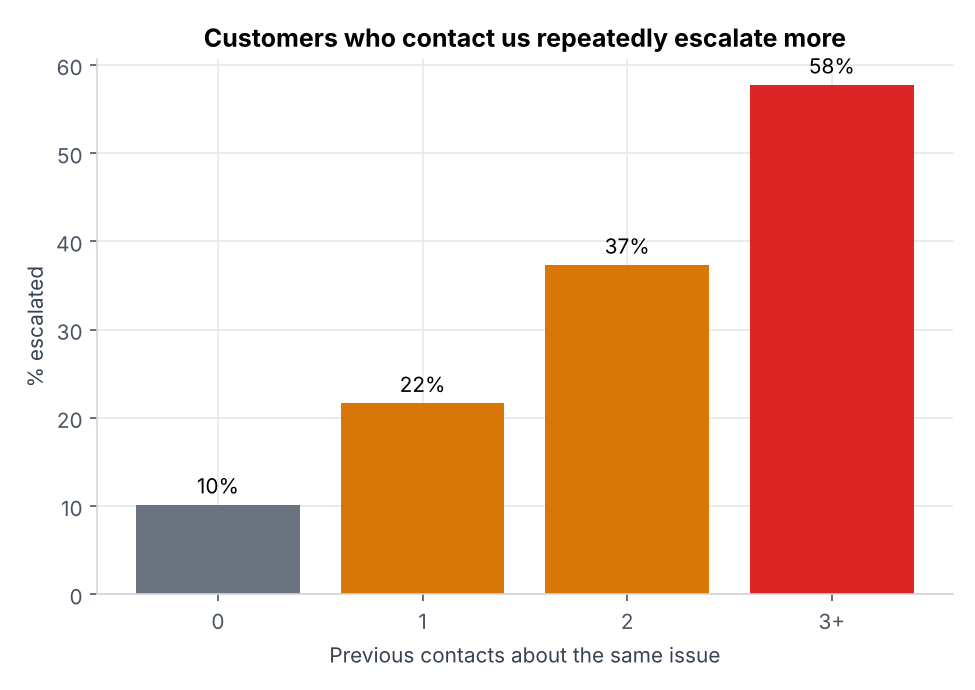
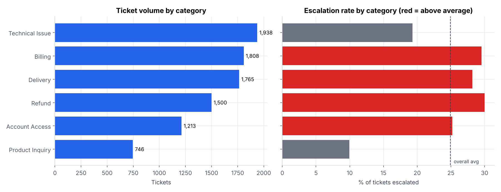
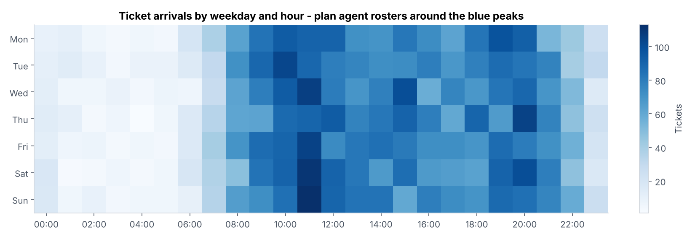
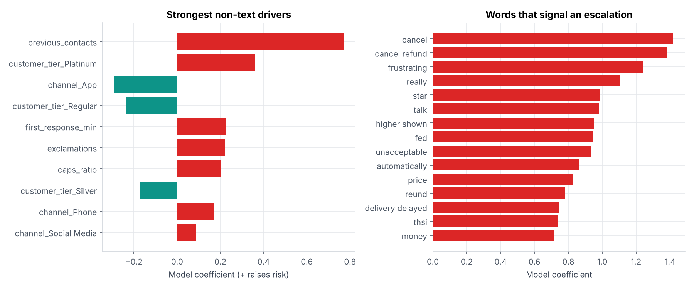

# 🎧 Support Ticket AI — Auto-Routing, Sentiment & Escalation Prediction


An end-to-end data analytics + AI project for a customer-support team: clean a messy CRM export,
analyse operations KPIs with SQL, and build three NLP/ML models that **route tickets automatically,
detect angry customers, and predict which tickets will escalate** — served through an interactive Streamlit app.

> Built from my experience in contact-centre operations at Concentrix, where tickets were triaged by hand and escalations were spotted too late.

---

## 📌 Business problem

A support team handles ~1,500 tickets a month across Email, Chat, Phone, App and Social Media.

| Pain point | Impact |
|---|---|
| Tickets are routed manually | Slow first response, tickets bounce between teams |
| Angry customers are noticed late | Bad reviews, churn |
| **~25% of tickets escalate** to a manager | Senior-agent time wasted, CSAT drops by ~1 point |

**Goal:** use ticket text + basic metadata to auto-route tickets, flag negative sentiment, and rank open tickets by escalation risk so team leads can act *before* the escalation happens.

## 🏆 Results (tested on unseen June tickets)

| Model | What it does | Result |
|---|---|---|
| **Category classifier** (TF-IDF + Linear SVM) | Routes each ticket to 1 of 6 teams | **92.4% accuracy**, 0.92 macro-F1 (beat Naive Bayes and Logistic Regression) |
| **Sentiment classifier** (TF-IDF + Logistic Regression) | Positive / Neutral / Negative / Angry | 69% accuracy on a 4-class problem with noisy human labels; most errors are between neighbouring classes (Negative vs Angry) |
| **Escalation-risk model** (text + metadata, Logistic Regression) | Probability a ticket will escalate | **ROC-AUC 0.78** vs 0.76 for a metadata-only baseline. Reviewing the **top 20% riskiest tickets catches ~45% of all escalations** — 2.3× better than random review |

<p align="center"> </p>

## 💡 Key insights

1. **Repeat contacts are the #1 escalation driver.** Escalation rate climbs from ~10% on a first contact to **almost 58%** for customers contacting a 3rd+ time → first-contact resolution is the biggest lever.
2. **Refund, Billing and Delivery tickets escalate most** and Refunds take ~2× longer to resolve than any other category.
3. **Email is the slowest channel** (median first response in hours, not minutes) and escalates above average.
4. **Platinum customers escalate ~10 percentage points above average** — premium customers expect premium speed.
5. Ticket volume peaks **10:00–12:00 and 19:00–21:00** → roster more agents in those windows.

<p align="center"> </p>
<p align="center"></p>

## ✅ Recommendations

| # | Action | Backed by |
|---|---|---|
| 1 | Auto-route tickets using the category model; send low-confidence predictions to a human | 92% routing accuracy |
| 2 | Create a daily **"risk queue"** of the top 20% riskiest open tickets for team leads | Catches ~45% of escalations |
| 3 | Mandatory callback on a customer's **2nd contact** about the same issue | Escalation rate doubles from contact 1 → 2 |
| 4 | 2-hour SLA (or move to chat) for refund & billing emails | Email = slowest channel, refunds = most escalations |
| 5 | Shift agent rosters to cover the 10–12 and 19–21 peaks | Hour × weekday heatmap |

---

## 🛠️ What's inside

```
support-ticket-ai/
├── data/
│   ├── generate_tickets.py       # creates the realistic, messy raw dataset
│   ├── raw/tickets_raw.csv       # 9,120 raw tickets (duplicates, typos, mixed dates...)
│   └── processed/tickets_clean.csv
├── sql/kpi_queries.sql           # 8 KPI queries: CTEs, window functions, CASE, subqueries
├── src/
│   ├── clean.py                  # cleaning + validation, writes a data-quality report
│   ├── sql_analysis.py           # loads data into SQLite, runs the KPI queries
│   ├── eda.py                    # exploratory charts
│   ├── train.py                  # trains & compares the 3 AI models
│   └── predict.py                # score any new ticket (CLI or Python)
├── notebooks/analysis.ipynb      # the full story with outputs, start here
├── reports/
│   ├── data_quality_report.md    # every cleaning step + rows affected
│   ├── sql_results.md            # output of every SQL query
│   ├── metrics.json              # all model metrics
│   └── figures/                  # all charts
├── models/                       # trained models (.joblib)
├── app.py                        # Streamlit app
└── run_pipeline.py               # runs everything end to end
```

### 1 · Data cleaning (`src/clean.py`)
The raw export has the same problems as a real CRM dump. Every fix is logged in [`reports/data_quality_report.md`](reports/data_quality_report.md):

- removed 120 duplicate rows and 30 junk tickets (`"test"`, `"na"`, empty)
- standardised 559 category labels (`billing`, ` Billing `, `Technical_Issue` → one spelling) and 343 channel labels
- parsed **3 different date formats** explicitly (never letting pandas guess day vs month)
- nulled 25 impossible response times (negative / 99,999 min) and imputed 293 values with the **channel median**
- masked order numbers, pincodes and amounts in text (privacy + less noise for the model)
- validation `assert`s so the pipeline fails loudly if bad data gets through

### 2 · SQL analysis (`sql/kpi_queries.sql`)
KPI snapshot, category & channel performance, repeat-contact buckets (`CASE`), monthly trend, agent ranking with `RANK() OVER`, peak hours, and tier vs overall comparison with a subquery. Results: [`reports/sql_results.md`](reports/sql_results.md).

### 3 · AI models (`src/train.py`)
- **Text features:** word n-grams (meaning) + character n-grams (robust to typos like *"refnd"*, *"delivred"*) and Hinglish phrases.
- **Time-based validation:** train on Jan–May, test on June — mirrors real use and avoids an over-optimistic random split.
- **Model comparison:** Naive Bayes vs Logistic Regression vs Linear SVM for routing.
- **Baseline first:** the escalation model is compared to a metadata-only baseline to prove the text adds value.
- **Explainability:** model coefficients show *why* a ticket is risky (repeat contacts, tier, slow response, words like *"cancel"*, *"unacceptable"*, *"fed up"*).

<p align="center"></p>

### 4 · Streamlit app (`app.py`)
- **Analyse a ticket:** paste text → category, team to route to, sentiment, escalation risk and recommended next step
- **Operations dashboard:** KPIs, monthly trend, escalation by category / channel / repeat contacts, with filters
- **Batch scoring:** upload a CSV of tickets (try [`data/sample/sample_tickets.csv`](data/sample/sample_tickets.csv)) → download them scored and sorted by risk

```bash
python src/predict.py "I was charged twice and NOBODY is replying!!" --channel Email --tier Gold --previous-contacts 3
```
```json
{ "category": "Billing", "route_to": "Payments & Billing team", "sentiment": "Angry",
  "escalation_risk": 0.87, "risk_level": "HIGH",
  "recommended_action": "Assign a senior agent now and call the customer back within 1 hour." }
```

---

## ▶️ Run it yourself

```bash
git clone https://github.com/saziaparween89/support-ticket-ai.git
cd support-ticket-ai
pip install -r requirements.txt

python run_pipeline.py      # data -> cleaning -> SQL -> EDA -> models (~30 seconds)
streamlit run app.py        # open http://localhost:8501
```

## 📝 About the data
Real support tickets contain customer names, phone numbers and order details, so they can't be published.
The dataset is **simulated** with [`data/generate_tickets.py`](data/generate_tickets.py) to reproduce the patterns of real
contact-centre data: overlapping categories, typos, Hinglish, angry repeat contacts, ~6% mis-tagged categories,
disagreeing sentiment labels, missing values, duplicates and mixed date formats. Exact numbers will differ on real
data, but the cleaning, SQL, modelling and evaluation approach transfers directly.

## 🔭 Next steps
- Swap TF-IDF for sentence embeddings or a fine-tuned small transformer for sentiment
- Add an LLM to draft a suggested first reply for each ticket
- Monitor model drift monthly and retrain when routing accuracy drops

---
**Sazia Parween** · Data Analyst · [Portfolio](https://saziaparween89.github.io) · [GitHub](https://github.com/saziaparween89) · saziaparween89@gmail.com
